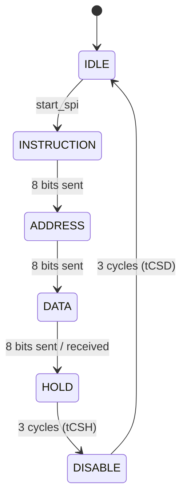

# SPI Master for ADXL362 (SystemVerilog)

**Status:** Simulation-verified in Vivado XSim: `PASS 672 checks, 0 errors`. Not yet tested on hardware.

A standalone SPI master written in SystemVerilog for the Analog Devices ADXL362 accelerometer, plus a self-checking testbench. The design implements single-byte register read and write from the datasheet (Rev. G), including the chip-select timing in Table 10.

## Spec

| Item | Value |
|---|---|
| Target | ADXL362 accelerometer (datasheet Rev. G) |
| SPI mode | Mode 0 (CPOL = 0, CPHA = 0), MSB-first |
| Frame | 24 SCLK pulses: command byte + address byte + data byte |
| Commands | `0x0B` register read, `0x0A` register write |
| Clocks | `iclk` = 100 MHz; `sclk` = 5 MHz (divider counts 0–9) |
| tCSS (CS fall → first SCLK rise, ≥ 100 ns) | 100 ns (meets the minimum exactly) |
| tCSH (last SCLK fall → CS rise, ≥ 20 ns) | 30 ns, from the HOLD state |
| tCSD (CS rise → next CS fall, ≥ 20 ns) | ≥ 30 ns guaranteed by the DISABLE state |

**Interface behaviour**
- `start_spi` is a one-cycle pulse. `address_in`, `data_in` and `rw_in` are captured when it fires in IDLE.
- `busy` is high in every state except IDLE. A new `start_spi` should only be sent once `busy` is low.
- `data_out` resets to `0xFF` and holds the last byte read. Writes do not change it.

**Ports**

| Direction | Signals |
|---|---|
| Input | `iclk`, `rst`, `start_spi`, `address_in[7:0]`, `data_in[7:0]`, `rw_in`, `miso` |
| Output | `cs`, `mosi`, `sclk`, `data_out[7:0]`, `busy` |

## State machine



`cs` is high in IDLE and DISABLE and low everywhere else. `rst` returns the FSM to IDLE from any state.

## Repo layout

| Path | Contents |
|---|---|
| `rtl/spi_master.sv` | SPI master RTL |
| `tb/spi_master_tb.sv` | Self-checking testbench with SPI-slave model |
| `docs/test_plan.md` | 16-check test plan with datasheet sources |
| `docs/bug_log.md` | Bugs found, root causes, fixes and evidence |

## How to simulate

1. In Vivado (tested on 2025.2), add `rtl/spi_master.sv` as a design source and `tb/spi_master_tb.sv` as a simulation source.
2. Set `spi_master_tb` as the simulation top.
3. Run Behavioral Simulation, then type `run all` in the Tcl console.
4. The last line before `$finish` should be:

```
PASS 672 checks, 0 errors
```

## Verification

**Testbench structure**
- **SPI-slave model:** a reactive model with a 64-byte register map (`0x00 = 0xAD`, `0x02 = 0xF2`). It decodes the command and address from MOSI, drives MISO on reads, and stores data on writes.
- **Directed tests:** register read and write, write-then-read, back-to-back reads, reset (idle and mid-transaction), input capture, and an ignored `start_spi` during a transaction.
- **Concurrent monitors:** run on every transaction and check SCLK idle level, MOSI setup and hold, pulse count, tCSS, tCSH, tCSD and `busy` timing.
- **Self-checking summary:** an error counter and an activity counter print one PASS/FAIL line at the end. The activity counter shows the monitors actually ran, so a clean run can't pass silently.

All expected values come from the datasheet and the design spec, not from the RTL. The full list of 16 checks and their sources is in [`docs/test_plan.md`](docs/test_plan.md).

**Where the 672 checks come from**

| Monitor | What it checks | Count |
|---|---|---|
| P1 | SCLK low while CS is high (every SCLK edge) | 376 |
| P2 tSU | MOSI setup before SCLK rise | 188 |
| P2 tHD | MOSI hold after SCLK rise | 72 |
| C1 | tCSS ≥ 100 ns | 8 |
| P4 | 24 SCLK pulses per transaction | 7 |
| C2 | tCSH ≥ 20 ns | 7 |
| C3 | tCSD ≥ 20 ns | 7 |
| I1 | `busy` falls 30 ns after CS rises | 7 |
| **Total** | | **672** |

Only the total (672) is measured by the testbench. The per-monitor split is worked out by analysis: 7 complete transactions plus E2, which is reset after 20 SCLK pulses. The P2 tHD count is the remainder (672 − 600). I1's count matches the 7 `I1 PASS` lines in the log. Per-monitor counters are planned so the split can be measured directly.

**Fault injection: proving the checks can fail**

A check that never fails proves nothing, so each timing monitor was deliberately broken to confirm it fires:

| Monitor | Injection | Result |
|---|---|---|
| P4 pulse count | expected 24 → 23 | fired 7/7, count = 24 |
| C1 tCSS | limit 100 → 101 ns | fired 8/8, gap = 100.0 ns |
| C2 tCSH | limit 20 → 35 ns | fired 7/7, gap = 30.0 ns |
| C3 tCSD | limit 20 → 51 ns | fired 5/5, gap = 50.0 ns |
| P1 SCLK idle | `force sclk = 1` while CS is high | fired |
| I2 ignored pulse | `start_spi` held high instead of pulsed | count = 2, check failed |
| Summary | C3 at 51 ns | `FAIL 672 checks, 5 errors` |

The E2 reset-mid-transaction check was verified in the waveform: just before reset `data_out` is `0xAF` (part-way through reading `0xAB`), and reset returns it to `0xFF`.

## Bugs found

- **2 design issues** found by checking the RTL against the datasheet: CS hold time (tCSH) and CS disable time (tCSD) were not enforced. Fixed by adding the HOLD and DISABLE states.
- **4 testbench bugs** found and fixed: same-timestep races between monitors, a reset check that could never fail, one monitor depending on another monitor's condition, and a reset-time `x → 1` edge being recorded as a real CS rise.
- The final testbench found **no bugs** in the DUT.

Details, root causes and evidence for each one are in [`docs/bug_log.md`](docs/bug_log.md).

## Known limitations

- tCSS has zero margin: it meets the 100 ns minimum exactly. A setup wait state is planned.
- The P2 (MOSI setup/hold) monitors have not been fault-injected yet.
- MSB-first bit order (P3) has no dedicated monitor. It is covered indirectly, because the read and write byte checks only pass with the correct bit order.
- The E2 reset check is verified by waveform, not by fault injection.
- Behavioural simulation only. Not yet validated on hardware (Nexys A7 with a real ADXL362).
- Single-byte register read/write only. No FIFO read (`0x0D`) or multi-byte burst.

## How this was built

I wrote the RTL, the testbench and the test plan myself. I used Claude (an AI assistant) as a reviewer and coach: it pointed out where issues were, explained concepts, and gave general syntax examples, but did not write the design or testbench logic. This README was drafted with Claude from my test plan, bug log and design notes, and reviewed by me. Some commits carry an AI co-author tag, which is why Claude appears as a contributor.
